# 

A desktop app to import games from other launchers into Steam.


[](https://crowdin.com/project/full-steam-ahead)


[](https://ko-fi.com/creeperkatze)

## 🚀 Installation

Download the latest version for your platform from the [website](https://full-steam-ahead.creeperkatze.dev).

Also available in these stores:

- **[Flathub](https://flathub.org/apps/dev.creeperkatze.full-steam-ahead)** 

Prefer to build from source? See [🔒 Building from source](#-building-from-source) below.

## 🎮 Supported platforms

| Platform        | Windows | macOS | Linux |
| --------------- | ------- | ----- | ----- |
| Epic Games      | ✅      | ✅    | ✅    |
| GOG             | ✅      | ❌    | ✅    |
| itch.io         | ✅      | ✅    | ✅    |
| EA app          | ✅      | -     | ✅    |
| Ubisoft Connect | ✅      | -     | ✅    |
| Amazon Games    | ✅      | -     | -     |
| Xbox            | ✅      | -     | -     |
| Playnite        | ✅      | -     | -     |
| Bottles         | -       | -     | ✅    |
| Flatpak         | -       | -     | ✅    |
| Heroic          | ❌      | ❌    | ✅    |
| Legendary       | ❌      | ❌    | ✅    |
| Lutris          | -       | -     | ✅    |
| MiniGalaxy      | -       | -     | ✅    |
| Proton          | -       | -     | ✅    |

## ✨ Features

<table>
<tr>
<td width="50%">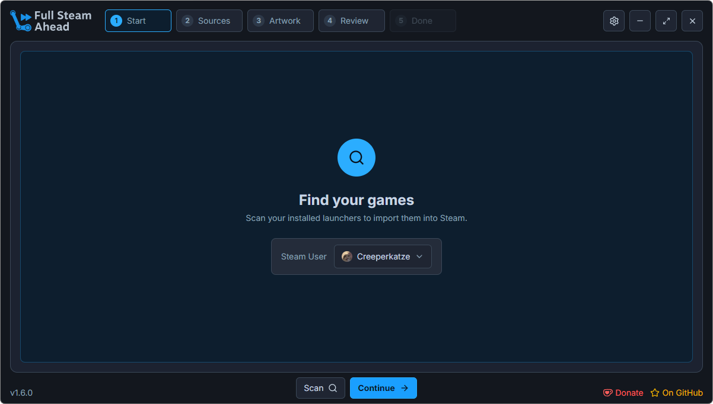</td>
<td width="50%"><h3>Pick your Steam user</h3>Scan your installed launchers and pick which Steam user to import into, right when you open the app.</td>
</tr>
<tr>
<td width="50%"><h3>Choose which games to import</h3>Every detected game from Epic, GOG, itch.io, and more is listed with a toggle, or add any executable manually as a custom non-Steam game.</td>
<td width="50%">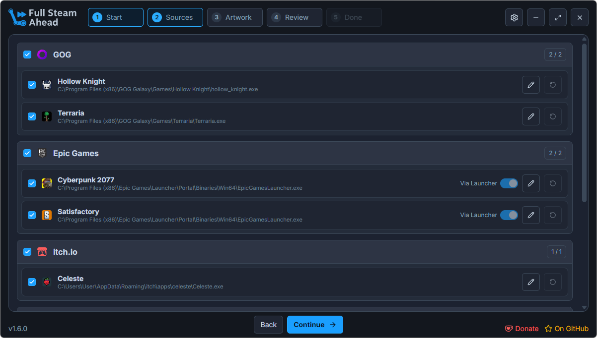</td>
</tr>
<tr>
<td width="50%">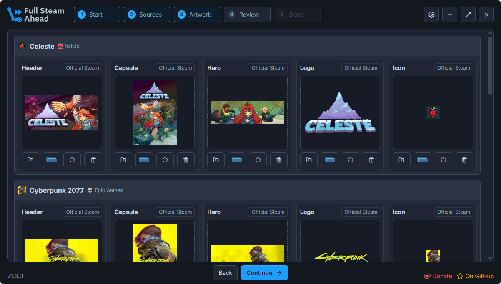</td>
<td width="50%"><h3>Review matched grid images, heroes, and logos</h3>Full Steam Ahead fetches matching grid images, hero art, logos, and icons for every game it imports.</td>
</tr>
<tr>
<td width="50%"><h3>Browse custom artwork on SteamGridDB</h3>Browse SteamGridDB's full library for every game and swap in the artwork you actually want.</td>
<td width="50%">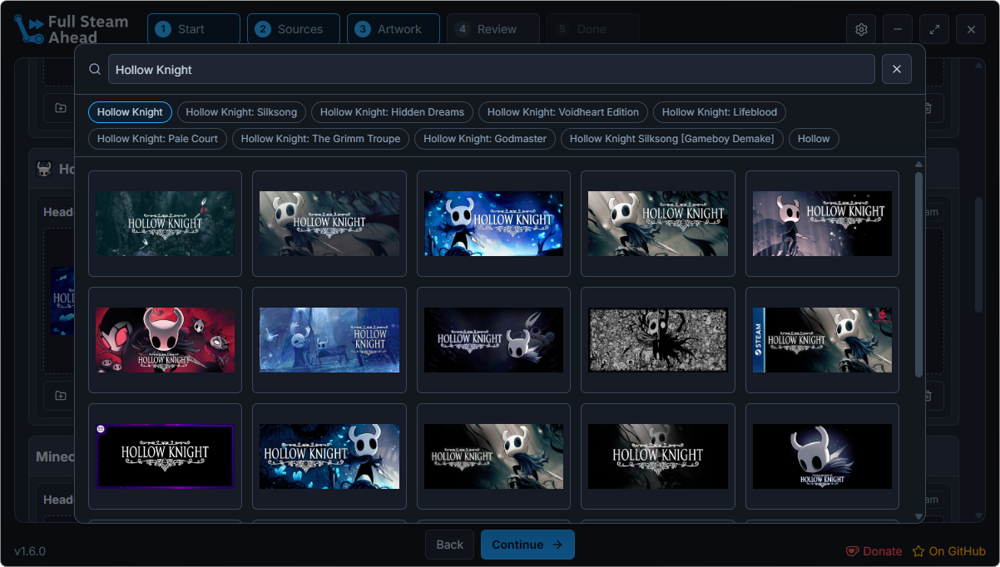</td>
</tr>
<tr>
<td width="50%">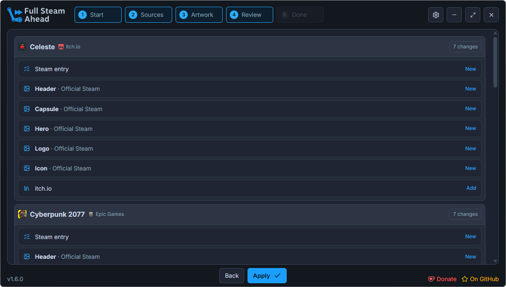</td>
<td width="50%"><h3>Review before you apply anything</h3>See every Steam entry and launcher link that's about to be added or updated before you apply anything.</td>
</tr>
<tr>
<td width="50%"><h3>All done, with an automatic backup</h3>Changes are applied and a backup of your Steam config is created automatically, so you can always roll back.</td>
<td width="50%">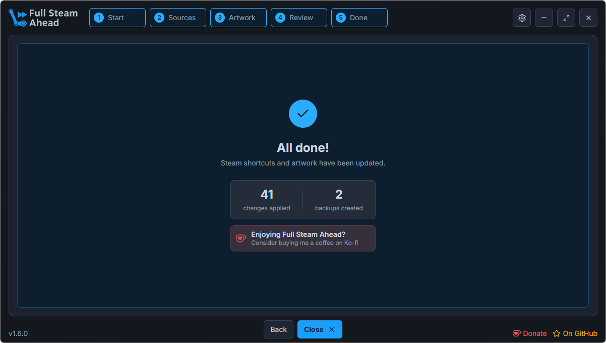</td>
</tr>
<tr>
<td width="50%">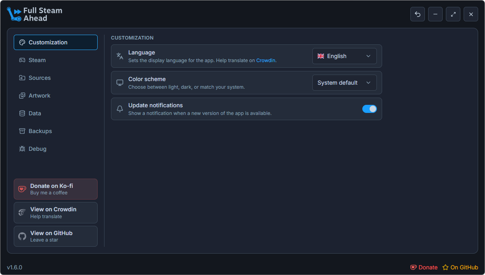</td>
<td width="50%"><h3>Make it feel like yours</h3>Choose your language and switch between light, dark, or system color scheme, right from the settings.</td>
</tr>
<tr>
<td width="50%"><h3>Decide how Steam gets handled</h3>Decide whether Steam is closed and restarted automatically, group imports into per-launcher collections, and override the install location if it isn't auto-detected.</td>
<td width="50%">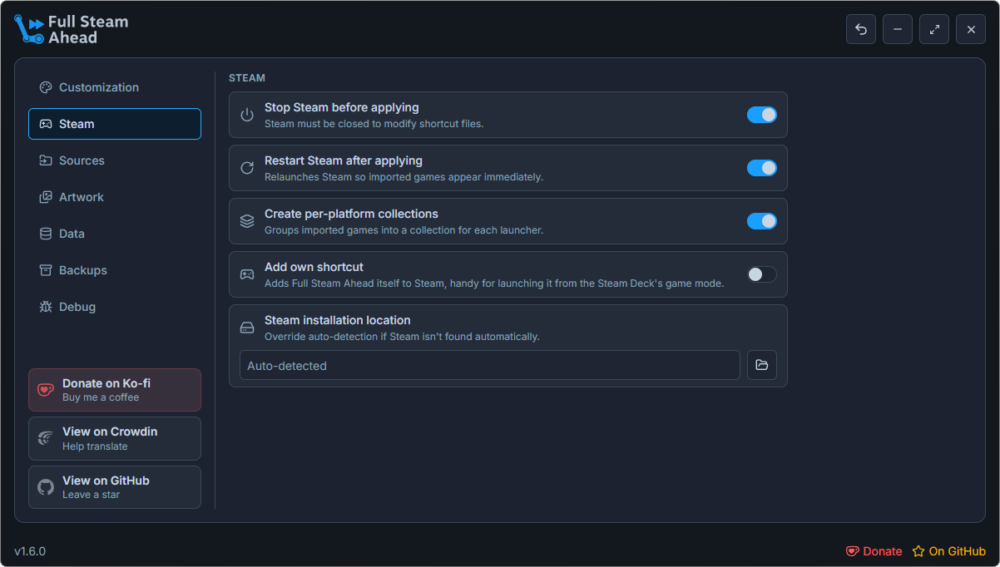</td>
</tr>
<tr>
<td width="50%">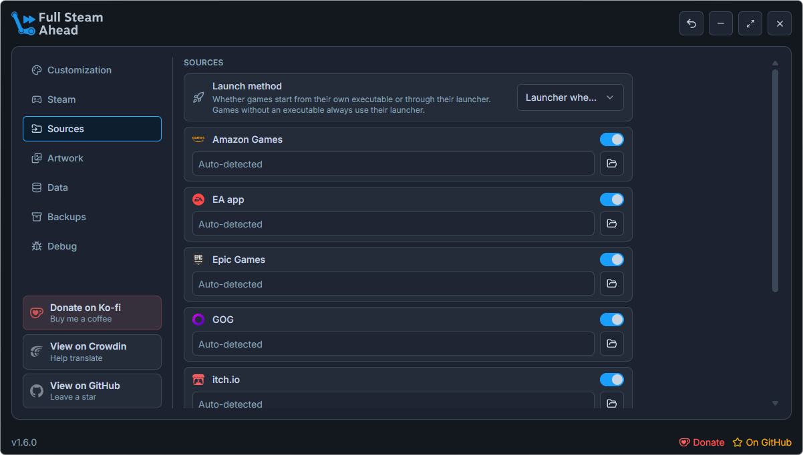</td>
<td width="50%"><h3>Configure sources</h3>Enable or disable each launcher, and override its auto-detected install path if Full Steam Ahead can't find it on its own.</td>
</tr>
<tr>
<td width="50%"><h3>Choose where your artwork comes from</h3>Choose which source artwork is fetched from automatically, Steam or SteamGridDB, then enable SteamGridDB browsing and add your own API key.</td>
<td width="50%">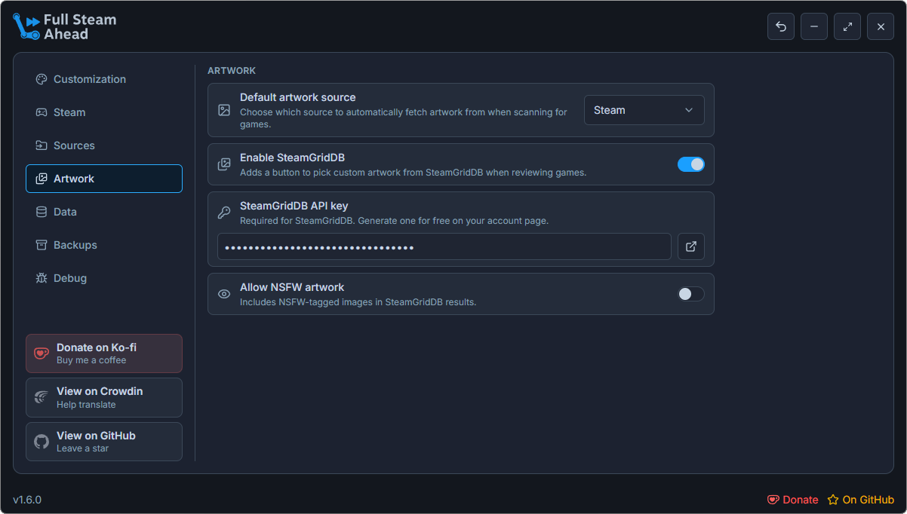</td>
</tr>
<tr>
<td width="50%">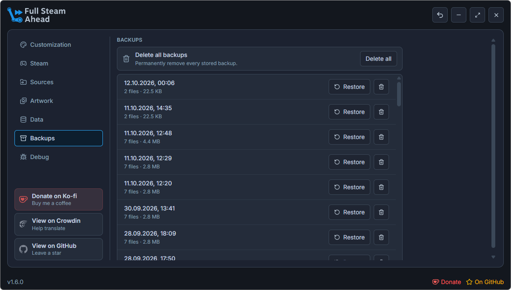</td>
<td width="50%"><h3>Every backup, one restore away</h3>Browse every automatic backup Full Steam Ahead has made, restore any of them, or clean up the ones you don't need.</td>
</tr>
</table>

## 🔒 Building from source

**Prerequisites:** [Node.js](https://nodejs.org), [pnpm](https://pnpm.io), and [Rust](https://rustup.rs)

```bash
# Clone the repository
git clone https://github.com/creeperkatze/full-steam-ahead.git
cd full-steam-ahead

pnpm install

# Build for your platform
pnpm build
```

The resulting installer is placed in `src-tauri/target/release/bundle/`.

## 👨‍💻 Development

### Setup

```bash
git clone https://github.com/creeperkatze/full-steam-ahead.git
cd full-steam-ahead

pnpm install
```

### Running

```bash
pnpm dev
```

## 🌐 Translating

Translations are managed on [Crowdin](https://crowdin.com/project/full-steam-ahead). You can contribute without any technical knowledge, just pick your language and start translating.

New translations are automatically pulled every Monday.

## 🤝 Contributing

Contributions are always welcome!

Please ensure you run `pnpm lint` and `pnpm fmt:check` before opening a pull request.

## 📜 License

AGPL-3.0
